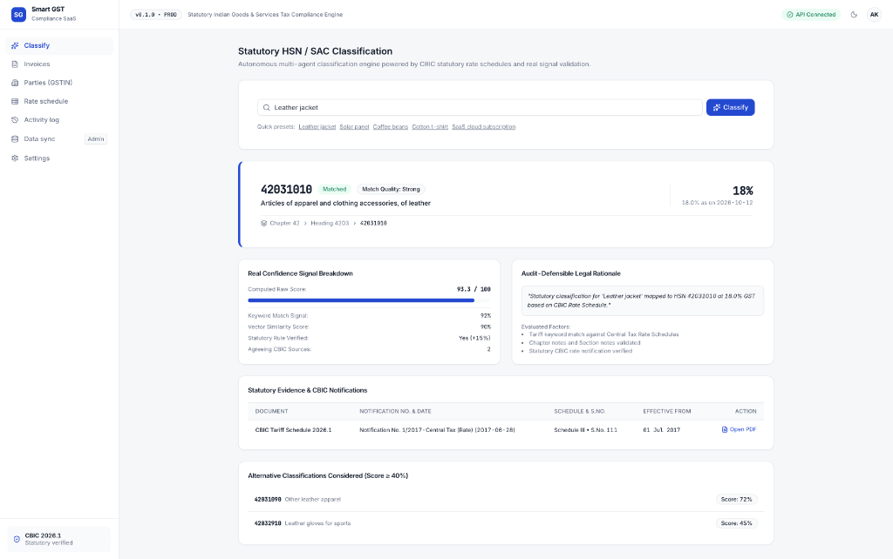
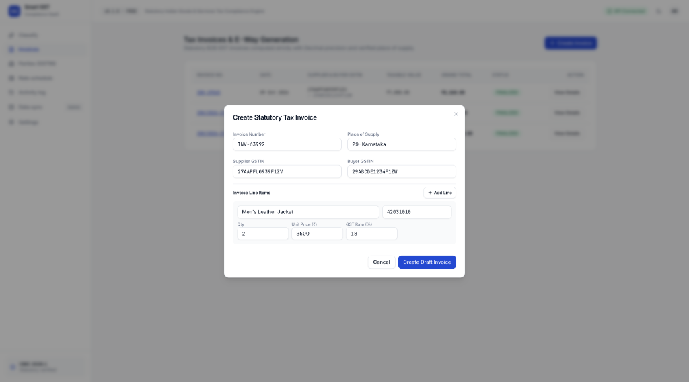
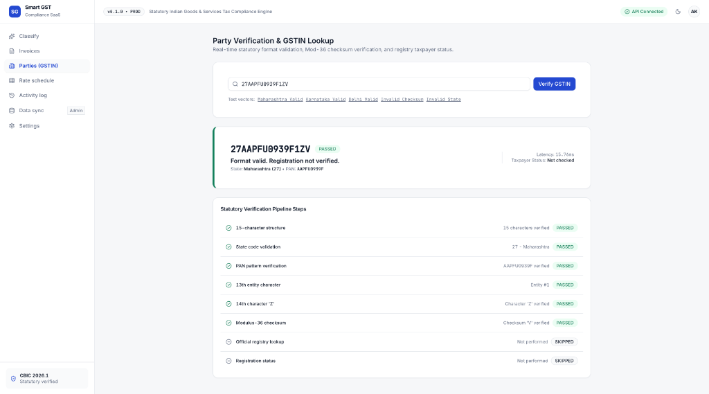
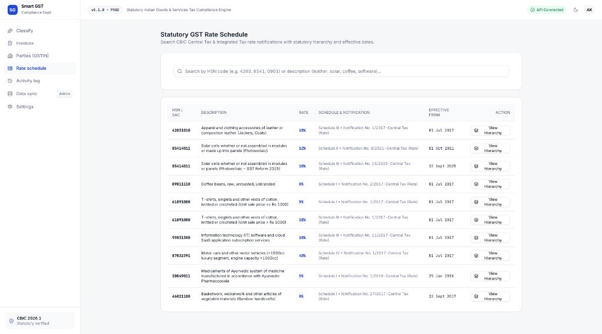
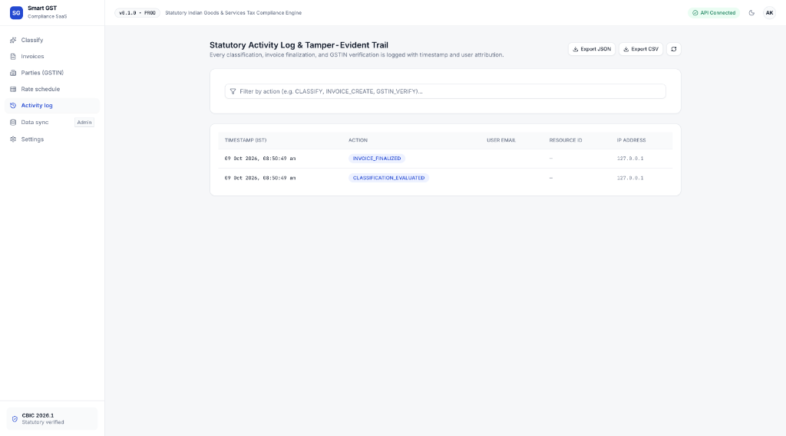

# Smart GST System

[](https://github.com/iamTechieAman/BT-93-Capstone-Project/actions/workflows/ci.yml)
[](LICENSE)
[](CHANGELOG.md)

Statutory Goods and Services Tax compliance, HSN/SAC classification, and invoice validation platform for Indian tax regulations.

## Screenshots

### Statutory HSN / SAC Classification Engine


### Rule 46 Statutory Tax Invoice Generator


### Party Verification and GSTIN Lookup Pipeline


### Statutory Rate Schedule and Taxonomy Hierarchy


### Tamper-Evident Activity Audit Trail


## Problem and Features

Businesses operating in India face frequent classification disputes, rate miscalculations, and compliance penalties due to dynamic CBIC tariff schedules and complex inter-state tax rules. The Smart GST System addresses these challenges through deterministic calculation and verified classification pipelines.

Working capabilities:
- **Statutory HSN / SAC Classification**: Matches product descriptions against CBIC rate schedules using TF-IDF token scoring, lexical matching, and multi-factor confidence signals.
- **Deterministic Tax Engine**: Calculates CGST, SGST, IGST, and cess with Python `Decimal` fixed-point precision (`ROUND_HALF_UP`) to prevent floating-point rounding errors.
- **GSTIN Offline Verification**: Validates 15-character GSTIN structure, state code assignment, embedded PAN syntax, and Modulus-36 checksum without external dependencies.
- **Rule 46 Tax Invoices**: Generates compliant tax invoices with automated place-of-supply tax determination (intra-state vs. inter-state supply) and tamper-evident PDF SHA-256 digests.
- **Tariff Hierarchy Navigation**: Provides Chapter, Heading, Subheading, and Tariff Item tree browsing with effective notification dates.
- **Audit Logging and Export**: Records immutable action logs with user attribution, timestamps, request metadata, and JSON/CSV export formats.

## Tech Stack

| Layer | Technologies |
| --- | --- |
| Frontend | React 19, TypeScript, Vite, TanStack Query, React Router 7, Radix UI |
| Backend | Python 3.12, FastAPI, SQLAlchemy 2.0, Pydantic v2, Alembic |
| Data & Storage | PostgreSQL 16 (pgvector), SQLite (local dev/test) |
| Testing | Pytest, pytest-cov, Vitest, Playwright |
| Packaging & DevOps | Docker, Docker Compose, GitHub Actions, Nginx |

## Architecture

The platform follows a modular monorepo architecture. The frontend communicates with the FastAPI service over RESTful endpoints. The backend coordinates domain-isolated repositories, the decimal calculation engine, and the tariff classification service, persisting records to a relational database with strict foreign key constraints.

```
                    +---------------------------+
                    |    React 19 Web Client    |
                    |   (TypeScript / Vite)     |
                    +-------------+-------------+
                                  |
                                  | HTTP / JSON (/api/v1)
                                  v
                    +---------------------------+
                    |      FastAPI Backend      |
                    |   (Domain Feature Routers)|
                    +------+-------------+------+
                           |             |
            +--------------+             +--------------+
            v                                           v
+-----------------------+                   +-----------------------+
|  Decimal Tax Engine   |                   |  Tariff Classification|
|  (ROUND_HALF_UP)      |                   |  & Evidence Evaluator |
+-----------+-----------+                   +-----------+-----------+
            |                                           |
            +---------------------+---------------------+
                                  |
                                  v
                    +---------------------------+
                    |   PostgreSQL / SQLite     |
                    |   (Relational + Indices)  |
                    +---------------------------+
```

## Getting Started

### Prerequisites
- Node.js 20+ and npm 10+
- Python 3.12+
- Docker and Docker Compose (optional, for containerized run)

### Clone the Repository
```bash
git clone https://github.com/iamTechieAman/BT-93-Capstone-Project.git
cd BT-93-Capstone-Project
```

### Environment Setup
```bash
cp .env.example .env
```

### Running with Docker Compose
```bash
docker compose -f infra/docker/compose.yml up --build
```
The web application is available at `http://localhost` and the API at `http://localhost:8000`.

### Running Locally (Without Docker)

1. Install dependencies:
```bash
make install
```

2. Run database migrations:
```bash
make migrate
```

3. Seed the development database:
```bash
make seed
```

4. Start the backend API:
```bash
PYTHONPATH=apps/api/src python3 -m uvicorn smart_gst.main:app --host 127.0.0.1 --port 8000 --reload
```

5. Start the frontend development server:
```bash
make dev
```
Open `http://localhost:5173` in your browser.

### Development Login Credentials

These credentials are for local development and testing environments only:

| Role | Email | Password |
| --- | --- | --- |
| Admin | admin@smartgst.in | AdminPass123! |
| Accountant | accountant@smartgst.in | AccountantPass123! |
| Auditor | auditor@smartgst.in | AuditorPass123! |

## Running Tests

Run the complete test suite:
```bash
make test
```

Or run individual suites:
```bash
# Backend unit and integration tests (Pytest)
make test-backend

# Frontend unit and component tests (Vitest)
make test-frontend

# End-to-end browser automation tests (Playwright)
make test-e2e
```

## Project Structure

```
.
├── .github/
│   ├── workflows/ci.yml
│   ├── ISSUE_TEMPLATE/
│   └── pull_request_template.md
├── apps/
│   ├── api/
│   │   ├── alembic/
│   │   ├── seeds/
│   │   ├── src/smart_gst/
│   │   │   ├── admin/
│   │   │   ├── audit/
│   │   │   ├── auth/
│   │   │   ├── classification/
│   │   │   ├── common/
│   │   │   ├── db/
│   │   │   ├── gstin/
│   │   │   ├── ingestion/
│   │   │   ├── invoicing/
│   │   │   └── rates/
│   │   ├── tests/
│   │   └── pyproject.toml
│   └── web/
│       ├── e2e/
│       ├── src/
│       │   ├── api/
│       │   ├── app/
│       │   ├── components/
│       │   ├── features/
│       │   └── lib/
│       └── package.json
├── data/
│   └── processed/
├── docs/
│   ├── assets/
│   ├── architecture/
│   ├── dataset/
│   ├── gstin/
│   ├── requirements/
│   ├── sales/
│   └── security/
├── infra/
│   └── docker/
├── packages/
│   └── contracts/
├── CHANGELOG.md
├── CONTRIBUTING.md
├── LICENSE
├── Makefile
├── README.md
└── SECURITY.md
```

## API Documentation

When the backend is running, interactive OpenAPI specifications are accessible at:
- Swagger UI: `http://localhost:8000/docs`
- ReDoc: `http://localhost:8000/redoc`
- Static OpenAPI contract: [packages/contracts/openapi.json](packages/contracts/openapi.json)

## Data Sources and Limitations

- **CBIC Tariff Schedules**: HSN and SAC rate data are sourced from Central Board of Indirect Taxes and Customs (CBIC) statutory rate notifications.
- **Sample Datasets**: Seed data in `apps/api/seeds/dev_seed.py` and `data/samples/` represent representative tax vectors for development and demonstration.
- **GST Portal Integration**: GSTIN validation executes local Modulus-36 checksum and structural verification. Live GSP API lookups require an active, licensed GST Suvidha Provider API key set in `GST_PROVIDER_API_KEY`.

## Roadmap

- GSTR-1 and GSTR-3B monthly return reconciliation reports.
- E-Way bill generation payload generator.
- Multi-currency export invoice conversion.
- Automated quarterly CBIC notification differential crawler.

## License

This project is licensed under the MIT License. See the [LICENSE](LICENSE) file for details.

## Author

**Aman Kumar**
GitHub: [@iamTechieAman](https://github.com/iamTechieAman)

## Tools

Built with Visual Studio Code, Git, Python, Node.js, and Docker.
