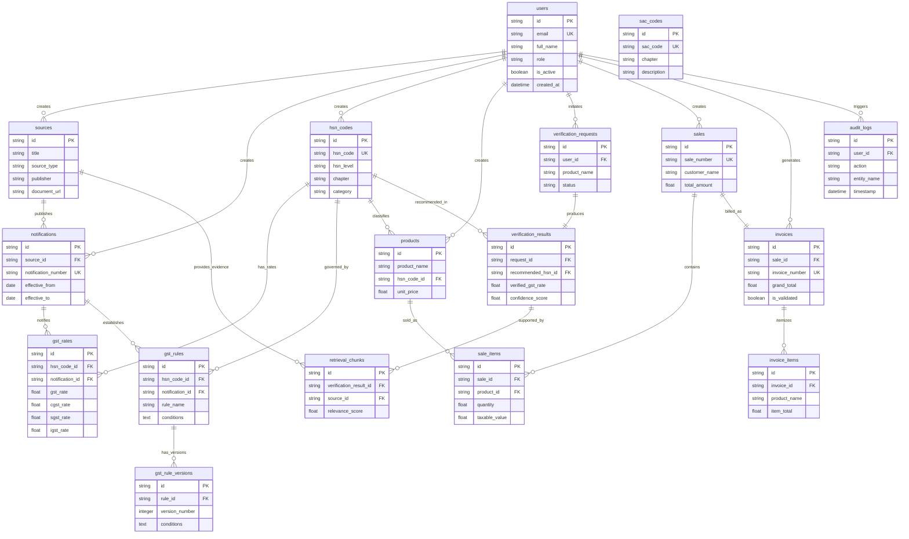

# Smart GST System — Entity Relationship (ER) Diagram

## 1. Overview & Legend

The Entity Relationship (ER) diagram below models the complete 17-entity database schema for the Smart GST System, covering:
- **Authentication & Governance**: `users`, `audit_logs`
- **Statutory Master Data**: `sources`, `notifications`, `hsn_codes`, `sac_codes`, `gst_rates`, `gst_rules`, `gst_rule_versions`
- **Product Catalog & Sales**: `products`, `sales`, `sale_items`, `invoices`, `invoice_items`
- **AI Verification & RAG**: `verification_requests`, `verification_results`, `retrieval_chunks`

---

## 2. Mermaid Entity-Relationship Diagram

---

## 3. Entity Cardinality Summary

1. **User Relationships**: `users` act as creators (`1:N`) for `sources`, `notifications`, `hsn_codes`, `products`, `sales`, and `invoices`.
2. **Tax Rate Provenance**: Each `hsn_code` has zero or more `gst_rates` (`1:N`), which are anchored to a statutory CBIC `notification` (`N:1`).
3. **Rule Versioning**: Each `gst_rule` tracks historical changes in `gst_rule_versions` (`1:N`).
4. **Verification & Evidence**: Each `verification_request` yields exactly one `verification_result` (`1:1`), which cites multiple `retrieval_chunks` (`1:N`) originating from `sources`.
5. **Sales & Billing**: Each `sale` maps to one `invoice` (`1:1`), and both contain itemized child arrays (`sale_items` and `invoice_items`).
