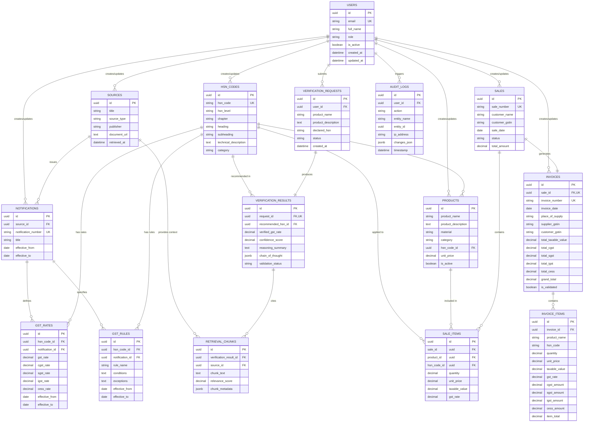

# Entity-Relationship (ER) Diagram

## Executive Overview

The following Mermaid ER diagram illustrates the complete 15-table relational schema for the **Smart GST Verification & Sales System**, showing entity attributes, primary keys, foreign keys, cardinality, and domain relationships.

---

##  Complete System ER Diagram

---

##  Key Domain Relationship Highlights

1. **Tax Rates & Legal Provenance**:
   - `NOTIFICATIONS` links `SOURCES` to `GST_RATES` and `GST_RULES`.
   - Every tax rate applied to an HSN code is directly traceable to an official legal notification.

2. **Multi-Agent Verification & Evidence Trail**:
   - A `VERIFICATION_REQUEST` produces exactly one `VERIFICATION_RESULT`.
   - A `VERIFICATION_RESULT` cites one or more `RETRIEVAL_CHUNKS` linked back to authoritative `SOURCES`.

3. **Sales to Invoicing Pipeline**:
   - A `SALE` contains multiple `SALE_ITEMS`.
   - A `SALE` generates exactly one validated `INVOICE`.
   - An `INVOICE` contains detailed `INVOICE_ITEMS` with calculated CGST, SGST, IGST, and Cess tax amounts.
