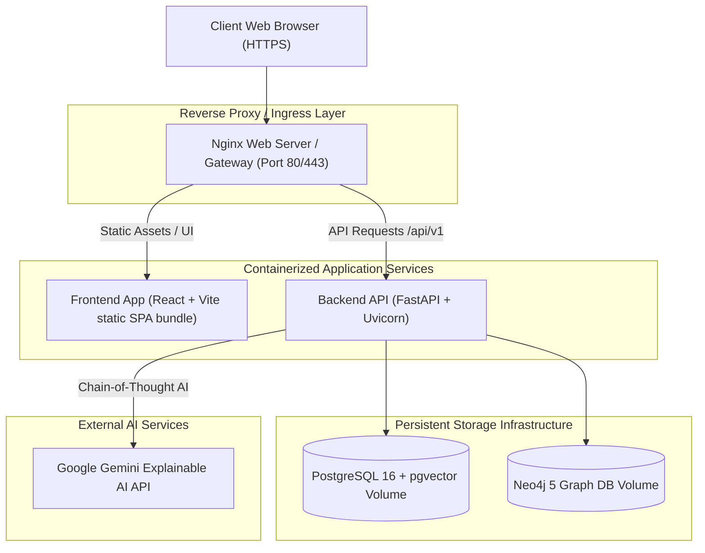

# Production Deployment & Infrastructure Guide

## 1. Overview

This document provides step-by-step instructions for deploying the **Smart GST Verifier & Compliance Engine** to production environments (Docker Compose, Kubernetes, AWS/GCP Cloud VMs) with SSL/TLS termination, database persistence, Neo4j graph indexing, and security hardening.

---

## 2. Infrastructure Architecture



---

## 3. Deployment Prerequisites

- **Server Hardware Minimums**: 4 vCPUs, 8 GB RAM, 50 GB NVMe Storage.
- **Installed Software**: Docker (v24.0+), Docker Compose (v2.20+), Git.
- **Domain & SSL**: Domain pointed to server IP with Let's Encrypt / Certbot SSL certificates.

---

## 4. Quick-Start Deployment (Docker Compose)

### Step 1: Clone Repository & Configure Environment Variables
```bash
git clone https://github.com/your-org/Smart-GST-System.git
cd Smart-GST-System

# Copy environment template
cp .env.example .env

# Edit .env with secure production credentials
nano .env
```

> **Security Warning**: Replace `SECRET_KEY`, `POSTGRES_PASSWORD`, and `NEO4J_PASSWORD` with random passwords before starting containers.

### Step 2: Build & Start Services
```bash
# Build production Docker images and launch containers in detached mode
docker-compose up -d --build
```

### Step 3: Verify Container Health
```bash
docker-compose ps
```

Expected output:
- `smart_gst_postgres`: `healthy`
- `smart_gst_neo4j`: `running`
- `smart_gst_backend`: `running`
- `smart_gst_frontend`: `running`

### Step 4: Run Initial Database Seed & Migration
```bash
docker-compose exec backend python -m app.db.seed
```

---

## 5. Database Migration & Backup Strategy

### 5.1 Automated PostgreSQL Backup Script
Create `/etc/cron.daily/backup_smart_gst_postgres`:
```bash
#!/bin/bash
BACKUP_DIR="/var/backups/smart_gst"
mkdir -p $BACKUP_DIR
TIMESTAMP=$(date +"%Y%m%d_%H%M%S")

docker exec smart_gst_postgres pg_dump -U postgres -d smart_gst_db | gzip > "$BACKUP_DIR/smart_gst_$TIMESTAMP.sql.gz"

# Retain last 30 daily backups
find $BACKUP_DIR -type f -name "*.sql.gz" -mtime +30 -delete
```

### 5.2 Neo4j Graph Backup & Cypher Export
```bash
docker exec smart_gst_neo4j neo4j-admin database dump neo4j --to-path=/data/backups/
```

---

## 6. SSL / TLS Reverse Proxy Setup (Nginx + Certbot)

Install Certbot and generate SSL certificates:
```bash
sudo apt-get update && sudo apt-get install -y certbot python3-certbot-nginx
sudo certbot --nginx -d gst-verifier.yourdomain.com
```

Nginx site config `/etc/nginx/sites-available/gst-verifier`:
```nginx
server {
    listen 443 ssl http2;
    server_name gst-verifier.yourdomain.com;

    ssl_certificate /etc/letsencrypt/live/gst-verifier.yourdomain.com/fullchain.pem;
    ssl_certificate_key /etc/letsencrypt/live/gst-verifier.yourdomain.com/privkey.pem;

    location / {
        proxy_pass http://localhost:3000;
        proxy_set_header Host $host;
        proxy_set_header X-Real-IP $remote_addr;
    }

    location /api/v1/ {
        proxy_pass http://localhost:8000/api/v1/;
        proxy_set_header Host $host;
        proxy_set_header X-Real-IP $remote_addr;
    }
}
```
