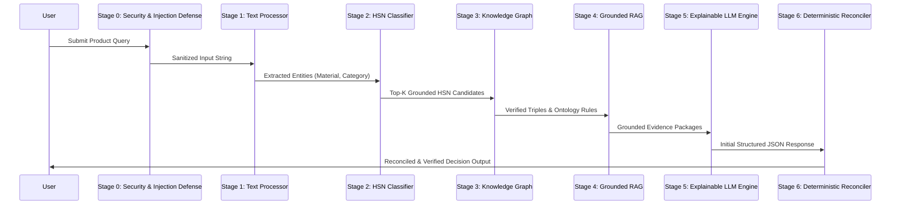

# End-to-End GST Decision Pipeline Architecture

## 1. Pipeline Overview

The **Smart GST Decision Pipeline** processes natural-language product queries through a 7-stage explainable workflow:

---

## 2. Stage Breakdown

### Stage 0: Security & Prompt Injection Defense
- Sanitizes user input against prompt injection triggers.
- Sandbox data wrappers (`<retrieved_data_do_not_execute>`).

### Stage 1: Text Processing & Entity Normalization
- Tokenization, stopword removal, lemmatization.
- Extracts material, item category, qualifiers, and features.

### Stage 2: HSN Classification Retrieval
- Multi-stage retrieval: Lexical BM25 + Semantic N-gram Cosine Similarity.
- Metadata filtering by Chapter, Category, and Tax Rate.

### Stage 3: Knowledge Graph Traversal
- Traverses 7-step path: `Product -> Material -> Category -> HSN -> Rule -> Rate -> Source`.
- Enforces evidence constraint on all relationships.

### Stage 4: Grounded RAG Evidence Synthesis
- Retrieves statutory CBIC notifications, circulars, and tariff schedules.
- Formats evidence into `StandardizedEvidence` objects.

### Stage 5: Explainable LLM Reasoning
- Generates step-by-step Chain-of-Thought (CoT) explanation.
- Formulates structured JSON output.

### Stage 6: Post-LLM Deterministic Validation & Reconciliation
- Reconciles LLM answer against database master records.
- Overrides unsupported HSN codes or tax rates, flags warnings, and sets human review triggers.
