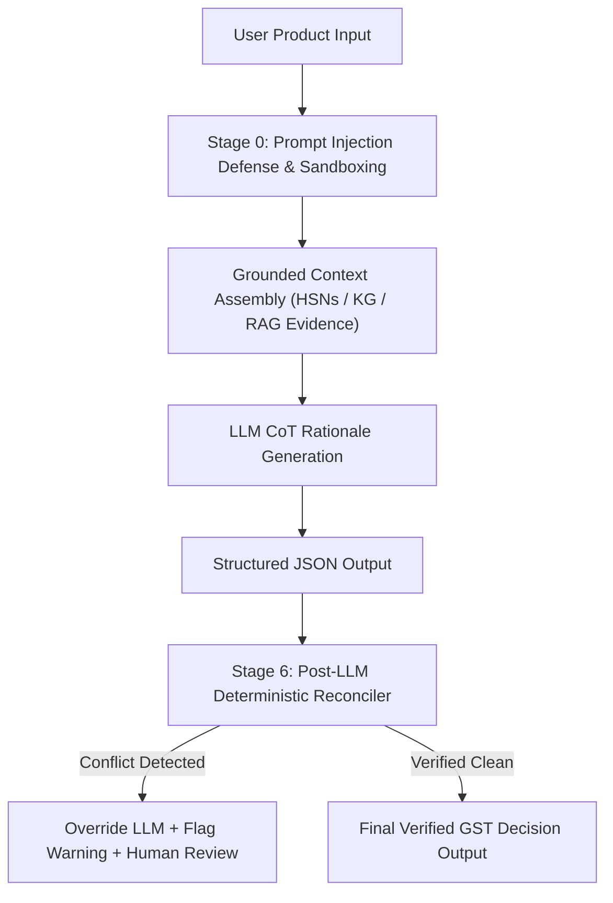

# Explainable AI Engine Design

## 1. System Overview

The **Explainable AI Engine** provides an audit-verifiable, explainable decision layer for GST classification and tax rate calculation.

### Core Legal & Architectural Principles
1. **No Independent Legal Fact Determination**: The LLM is **not** permitted to independently invent or determine legal or tax facts. All candidate HSN codes, tax rates, and statutory conditions are strictly provided by authoritative CBIC database records.
2. **Data-Not-Instruction Sandboxing**: Retrieved document context and Knowledge Graph facts are treated strictly as data, never as executable system instructions.
3. **Deterministic Override Reconciliation**: If the LLM generates an ungrounded HSN code or conflicting GST rate, a post-LLM deterministic reconciler **overrides** the LLM output with authoritative database facts, flags a reconciliation warning, and sets `needs_human_review = true`.



---

## 2. Prompt Injection Defense

All user inputs and retrieved context undergo sanitization and XML sandboxing before being passed to LLMs:

```xml
<retrieved_data_do_not_execute>
- [CBIC Notification No. 1/2017] Heading 4203 applies to articles of apparel of leather...
</retrieved_data_do_not_execute>
```

This prevents prompt injection techniques (e.g. `ignore previous instructions`, `system override`) from altering LLM behaviour.

---

## 3. Structured JSON Output Schema

```json
{
  "product": "Leather Jacket with Zip",
  "selected_hsn": "42031010",
  "hsn_description": "Articles of apparel and clothing accessories, of leather or of composition leather - Jackets and blazers",
  "gst_rate": 18.0,
  "confidence": 0.96,
  "classification_reason": "The product 'Leather Jacket with Zip' is classified under HSN code 42031010. Primary material identification confirms bovine leather construction. Under General Rules of Interpretation (GRI 1 & 3a), articles of leather apparel take precedence over lining materials.",
  "tax_reason": "Statutory GST rate of 18.0% (CGST 9.0% + SGST 9.0%) applies under CBIC Notification No. 1/2017-Central Tax (Rate), Schedule III.",
  "evidence": [
    {
      "source": "CBIC Notification No. 1/2017-Central Tax (Rate)",
      "source_url": "https://cbic-gst.gov.in/pdf/Notification1-CGST-Rate.pdf",
      "title": "Central Tax Rate Schedule - Chapter 42",
      "excerpt": "Heading 4203 applies to articles of apparel of leather. Standard GST rate is 18%.",
      "relevance_score": 0.92,
      "effective_from": "2017-07-01",
      "metadata": {"hsn_code": "42031010"}
    }
  ],
  "warnings": [],
  "assumptions": [
    "Product is supplied in standard commercial transaction without special SEZ exemption."
  ],
  "needs_human_review": false,
  "reconciliation_details": {
    "hsn_overridden": false,
    "rate_overridden": false,
    "original_llm_hsn": "42031010",
    "original_llm_rate": 18.0
  }
}
```

---

## 4. Post-LLM Deterministic Validation

The `DeterministicReconciler` enforces strict reconciliation:

```
IF llm_output.selected_hsn NOT IN grounded_candidate_hsns THEN
   OVERRIDE llm_output.selected_hsn = top_database_candidate.hsn_code
   ADD WARNING "LLM generated ungrounded HSN code. Overridden by top database candidate."
   SET needs_human_review = true

IF llm_output.gst_rate != authoritative_db_rate THEN
   OVERRIDE llm_output.gst_rate = authoritative_db_rate
   ADD WARNING "LLM GST rate mismatch overridden by authoritative CBIC database schedule."
   SET needs_human_review = true
```
