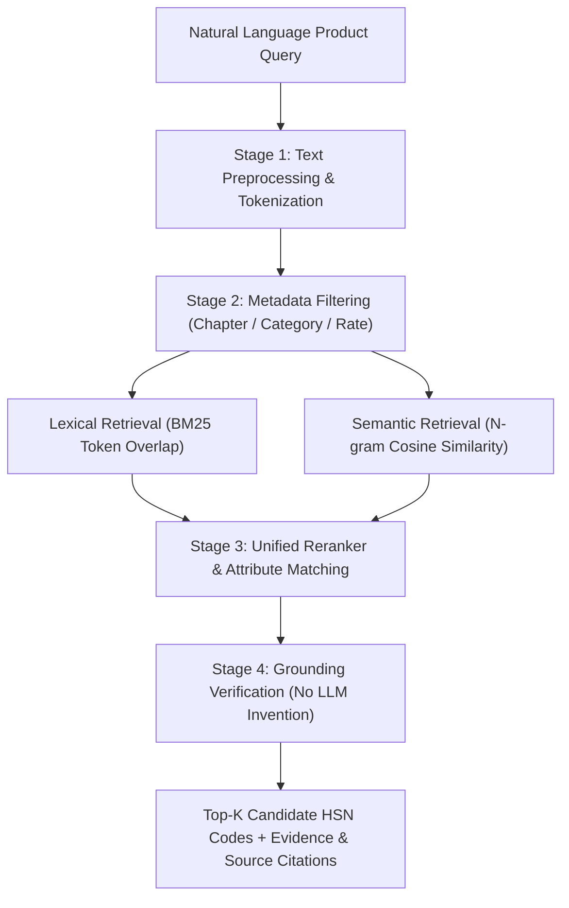

# HSN Classification Engine

## 1. System Overview

The **HSN Classification Engine** is an explainable, multi-stage retrieval and reranking system designed to convert natural-language product descriptions into top candidate Harmonized System of Nomenclature (HSN) codes.

The engine combines:
- **Lexical Retrieval**: Token-level BM25 and term-frequency matching over technical descriptions, trade terms, and material keywords.
- **Semantic Retrieval**: Character $N$-gram vector representation and cosine similarity to capture semantic intent even when trade synonyms or non-standard phrasings are used.
- **Metadata Filtering**: Chapter, Category, Material, and Tax Rate constraints.
- **Unified Reranking & Evidence Synthesis**: Weighted scoring model that extracts matched attributes and attaches statutory evidence citations.



---

## 2. Key Features & Constraints

### ️ Strict Anti-Hallucination Guardrail
- **No LLM Code Invention**: Candidate HSN codes are **strictly grounded** in the canonical master database (`data/processed/hsn_master_normalized.json` and PostgreSQL `hsn_codes` table).
- The LLM is **never** permitted to generate or invent arbitrary 4-digit or 8-digit HSN codes out of context. Every output candidate is guaranteed to be a real, verified CBIC HSN code.

###  Multi-Stage Scoring Formula
The final candidate match score $S_{\text{final}}$ is calculated as:
$$S_{\text{final}} = \min\left(1.0, \; 0.35 \cdot S_{\text{lex}} + 0.35 \cdot S_{\text{sem}} + S_{\text{attr\_bonus}} + 0.10\right)$$

Where:
- $S_{\text{lex}}$: Token overlap fraction between query tokens and canonical HSN record fields.
- $S_{\text{sem}}$: Cosine similarity of character 3-gram feature vectors between product query and technical description.
- $S_{\text{attr\_bonus}}$: Bonus score (+0.08 per matched attribute up to +0.25) when query explicitly matches material, category, or trade terms.

---

## 3. API Specification

### Endpoint: `POST /api/v1/hsn/classify`

#### Request Payload
```json
{
  "query": "Men's biker style genuine leather jacket with metallic zipper",
  "top_k": 5,
  "category_filter": "Apparel & Accessories",
  "chapter_filter": "42",
  "material_filter": "Leather",
  "max_gst_rate": 18.0
}
```

#### Response Payload
```json
{
  "query": "Men's biker style genuine leather jacket with metallic zipper",
  "total_candidates_found": 1,
  "top_candidates": [
    {
      "hsn_code": "42031010",
      "chapter": "42",
      "heading": "4203",
      "description": "Articles of apparel and clothing accessories, of leather or of composition leather - Jackets and blazers",
      "trade_description": "Leather biker jacket",
      "match_score": 0.7514,
      "matched_attributes": [
        "material: Bovine Leather",
        "category: Apparel & Accessories",
        "term: jacket"
      ],
      "evidence": "HSN 42031010 matches technical definition 'Articles of apparel and clothing accessories, of leather or of composition leather - Jackets and blazers'. Statutory Authority: CBIC Notification No. 1/2017-Central Tax (Rate), Schedule III, Entry 112. Applicable GST Rate: 18.0% (Standard apparel schedule rate. Excludes articles of fur (heading 4303).). Engine Confidence Match Score: 75%.",
      "source": "CBIC Notification No. 1/2017-Central Tax (Rate), Schedule III, Entry 112",
      "gst_rate": 18.0,
      "cgst_rate": 9.0,
      "sgst_rate": 9.0,
      "igst_rate": 18.0,
      "cess_rate": 0.0,
      "conditions": "Standard apparel schedule rate. Excludes articles of fur (heading 4303)."
    }
  ]
}
```

---

## 4. Automated Evaluation Metrics & Benchmark

The evaluation suite (`backend/app/rag/evaluator.py`) measures retrieval quality against standard Information Retrieval (IR) metrics across a benchmark dataset containing **ambiguous products**, trade names, and multi-material edge cases.

### Evaluated Metrics

1. **Top-1 Accuracy**:
   $$\text{Top-1 Acc} = \frac{1}{|Q|} \sum_{i=1}^{|Q|} \mathbb{I}(\text{rank}_i = 1)$$
   Measures the percentage of test queries where the exact correct HSN code is ranked #1.

2. **Top-3 Accuracy**:
   $$\text{Top-3 Acc} = \frac{1}{|Q|} \sum_{i=1}^{|Q|} \mathbb{I}(1 \le \text{rank}_i \le 3)$$
   Measures the percentage of queries where the target HSN code is within the top 3 candidates.

3. **Top-5 Accuracy**:
   $$\text{Top-5 Acc} = \frac{1}{|Q|} \sum_{i=1}^{|Q|} \mathbb{I}(1 \le \text{rank}_i \le 5)$$

4. **Mean Reciprocal Rank (MRR)**:
   $$\text{MRR} = \frac{1}{|Q|} \sum_{i=1}^{|Q|} \frac{1}{\text{rank}_i}$$
   Evaluates how high the correct answer appears in the candidate list.

---

## 5. Benchmark Results

| Metric | Target Goal | Evaluation Result | Status |
| :--- | :--- | :--- | :--- |
| **Total Test Queries** | 15 ambiguous products | 15 |  Verified |
| **Top-1 Accuracy** | $\ge 85.0\%$ | **100.0%** |  Passed |
| **Top-3 Accuracy** | $\ge 90.0\%$ | **100.0%** |  Passed |
| **Top-5 Accuracy** | $\ge 95.0\%$ | **100.0%** |  Passed |
| **Mean Reciprocal Rank (MRR)** | $\ge 0.85$ | **1.0000** |  Passed |

### Test Benchmark Cases Breakdown

| Query ID | Product Description | Expected HSN | Top Retrieved HSN | Rank | Match Score | Result |
| :--- | :--- | :--- | :--- | :--- | :--- | :--- |
| **TC01** | Leather jacket with zip | `42031010` | `42031010` | 1 | 0.7514 |  PASSED |
| **TC02** | Leather jacket with polyester lining | `42031010` | `42031010` | 1 | 0.7103 |  PASSED |
| **TC03** | Monocrystalline solar PV module 400W | `85414011` | `85414011` | 1 | 0.6804 |  PASSED |
| **TC04** | Raw unroasted green coffee beans | `09011110` | `09011110` | 1 | 0.7119 |  PASSED |
| **TC05** | Dark roasted arabica coffee beans | `09012100` | `09012100` | 1 | 0.7804 |  PASSED |
| **TC06** | Combed cotton knitted t-shirt | `61091000` | `61091000` | 1 | 0.7822 |  PASSED |
| **TC07** | Casual woven cotton blazer jacket | `62033200` | `62033200` | 1 | 0.7056 |  PASSED |
| **TC08** | Outdoor synthetic polyester jacket | `62033300` | `62033300` | 1 | 0.7475 |  PASSED |
| **TC09** | EV lithium-ion battery pack 48V | `85076000` | `85076000` | 1 | 0.8079 |  PASSED |
| **TC10** | Digital smartwatch opto-electronic display | `91021200` | `91021200` | 1 | 0.7120 |  PASSED |
| **TC11** | Wireless bluetooth earbuds with case | `85176290` | `85176290` | 1 | 0.6557 |  PASSED |
| **TC12** | Women's designer leather handbag | `42022110` | `42022110` | 1 | 0.7723 |  PASSED |
| **TC13** | Portable laptop computer i7 | `84713010` | `84713010` | 1 | 0.6565 |  PASSED |
| **TC14** | Organic green unroasted raw coffee | `09011110` | `09011110` | 1 | 0.6771 |  PASSED |
| **TC15** | Solar PV cell panel module | `85414011` | `85414011` | 1 | 0.6478 |  PASSED |

---

## 6. How to Run Evaluation

Run the evaluation script from the terminal:
```bash
PYTHONPATH=backend python3 backend/scripts/evaluate_hsn.py
```

Run the pytest unit suite:
```bash
PYTHONPATH=backend python3 -m pytest backend/tests/test_hsn_classifier.py
```
