# Smart GST Knowledge Graph Architecture & Ontology Design Specification

## 1. Executive Summary

The **Smart GST Knowledge Graph** ([`backend/app/knowledge_graph/query_service.py`](backend/app/knowledge_graph/query_service.py)) models the complex, multi-hop statutory relationships between commercial trade products, canonical 8-digit HSN codes, 6-digit SAC service codes, material compositions, tariff chapters, GST tax rates, exemption rules, and CBIC notification source provenance.

### Core Design Rules
1. **Mandatory Relationship Provenance**: Every edge created in the graph must carry an `evidence_source` property referencing an authoritative CBIC notification or statutory schedule.
2. **Dynamic UI Rendering**: The frontend Knowledge Graph explorer displays real, non-hardcoded relationship counts and nodes directly derived from backend graph queries.
3. **Automated Graph Integrity Auditing**: Built-in support for conflict detection, stale-rule detection, and orphan-node detection.

---

## 2. Node Taxonomy (13 Node Types)

```mermaid
classDiagram
    class Product {
        +string product_id
        +string name
        +string description
    }
    class HSN {
        +string code
        +string technical_description
        +string trade_description
    }
    class SAC {
        +string code
        +string description
    }
    class Chapter {
        +string chapter_code
        +string title
    }
    class Heading {
        +string heading_code
        +string description
    }
    class Subheading {
        +string subheading_code
        +string description
    }
    class Material {
        +string material_id
        +string name
    }
    class Category {
        +string category_id
        +string name
    }
    class GST_Rate {
        +string rate_id
        +float gst_rate
        +float cgst_rate
        +float sgst_rate
        +float igst_rate
    }
    class GST_Rule {
        +string rule_id
        +string rule_name
        +string conditions
    }
    class Notification {
        +string notification_id
        +string notification_number
        +string effective_from
    }
    class Condition {
        +string condition_id
        +string condition_text
    }
    class Source {
        +string source_id
        +string publisher
        +string document_url
    }
```

---

## 3. Relationship Schema (12 Edge Types)

| Relationship Type | Source Node | Target Node | Provenance / Purpose |
| :--- | :--- | :--- | :--- |
| `PRODUCT_HAS_ATTRIBUTE` | `Product` | `Material` | Material composition link (e.g., Leather, Cotton) |
| `PRODUCT_CANDIDATE_HSN` | `Product` | `HSN` | Candidate HSN match link from classification engine |
| `HSN_CHILD_OF` | `Subheading` | `Heading` | Subheading to 4-digit Heading hierarchy |
| `HSN_BELONGS_TO_CHAPTER` | `Heading` | `Chapter` | 4-digit Heading to 2-digit Chapter hierarchy |
| `HSN_APPLIES_TO_CATEGORY` | `HSN` | `Category` | Tariff classification category mapping |
| `HSN_REQUIRES_CONDITION` | `HSN` | `Condition` | Special condition or price threshold clause |
| `HSN_TAXED_AT` | `HSN` | `GST_Rate` | Statutory tax rate assignment |
| `HSN_GOVERNED_BY` | `HSN` | `GST_Rule` | Statutory rule governing HSN rate |
| `RULE_DEFINED_IN` | `GST_Rule` | `Notification` | CBIC notification specifying the rule |
| `RULE_EFFECTIVE_FROM` | `GST_Rule` | `Notification` | Start effective date of tax rule |
| `RULE_EFFECTIVE_TO` | `GST_Rule` | `Notification` | End effective date / expiration of tax rule |
| `SOURCE_SUPPORTS_RULE` | `Source` | `GST_Rule` | Authoritative source provenance backing the rule |

---

## 4. Graph Integrity & Validation Architecture

- **Evidence Constraint**: Enforced by [`KnowledgeGraphValidator`](backend/app/knowledge_graph/validator.py). Attempts to insert edges without `evidence_source` raise `GraphValidationError`.
- **Conflict Detection**: Queries identify HSN/SAC nodes mapped to multiple conflicting active tax rates.
- **Stale Rule Detection**: Identifies rules linked to notifications past their `effective_to` date.
- **Orphan Node Detection**: Identifies isolated nodes disconnected from the ontology.
