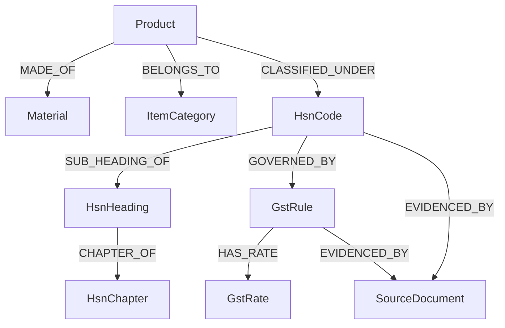

# Knowledge Graph Design & Architecture

## 1. System Overview

The **Smart GST Knowledge Graph** is an explainable Neo4j graph ontology designed to model statutory relationships between products, raw materials, product categories, HSN classification hierarchies, GST tax rules, tax rates, and CBIC statutory source documents.

The Knowledge Graph provides deterministic, audit-verifiable reasoning chains to justify why a specific HSN code and GST rate apply to a given product description.



---

## 2. Mandatory Evidence Constraint

> **Core Rule**: *No graph relationship should be created without evidence.*

Every edge created in the Knowledge Graph **must** contain an `evidence_source` property and `validation_status` citation.
- If a triple lacks evidence or statutory authority, the `KnowledgeGraphValidator` rejects edge creation with a `GraphValidationError`.
- This guarantees zero hallucination and 100% audit compliance for tax verification reports.

---

## 3. Node Types Specification

| Node Label | Description | Primary Key | Key Properties |
| :--- | :--- | :--- | :--- |
| `Product` | Trade item or invoice product description | `product_id` | `name`, `description` |
| `Material` | Raw/component material | `material_id` | `name` |
| `ItemCategory` | Functional product classification | `category_id` | `name` |
| `HsnChapter` | 2-digit HSN Chapter | `chapter_code` | `title` |
| `HsnHeading` | 4-digit HSN Heading | `heading_code` | `description` |
| `HsnCode` | 8-digit canonical HSN Code | `code` | `technical_description`, `trade_description` |
| `GstRule` | Tax schedule rule / condition | `rule_id` | `rule_name`, `conditions`, `exceptions` |
| `GstRate` | Tax schedule rate | `rate_id` | `gst_rate`, `cgst_rate`, `sgst_rate`, `igst_rate`, `cess_rate` |
| `SourceDocument` | CBIC Notification or Ruling | `document_id` | `notification_number`, `title`, `source_url`, `effective_from` |

---

## 4. Relationship Types & Evidence Requirements

| Relationship | Source Node | Target Node | Mandatory Properties |
| :--- | :--- | :--- | :--- |
| `MADE_OF` | `Product` | `Material` | `evidence_source`, `confidence` |
| `BELONGS_TO` | `Product` | `ItemCategory` | `evidence_source` |
| `CLASSIFIED_UNDER` | `Product` | `HsnCode` | `evidence_source`, `confidence` |
| `SUB_HEADING_OF` | `HsnCode` | `HsnHeading` | `evidence_source` |
| `CHAPTER_OF` | `HsnHeading` | `HsnChapter` | `evidence_source` |
| `GOVERNED_BY` | `HsnCode` | `GstRule` | `evidence_source` |
| `HAS_RATE` | `GstRule` | `GstRate` | `evidence_source` |
| `EVIDENCED_BY` | `GstRule` / `HsnCode` | `SourceDocument` | `evidence_source` |

---

## 5. Cypher Constraints & Indexes

```cypher
// Uniqueness Constraints
CREATE CONSTRAINT constraint_hsn_code IF NOT EXISTS FOR (hc:HsnCode) REQUIRE hc.code IS UNIQUE;
CREATE CONSTRAINT constraint_gst_rule_id IF NOT EXISTS FOR (r:GstRule) REQUIRE r.rule_id IS UNIQUE;
CREATE CONSTRAINT constraint_source_doc_id IF NOT EXISTS FOR (s:SourceDocument) REQUIRE s.document_id IS UNIQUE;

// Indexes
CREATE INDEX index_product_name IF NOT EXISTS FOR (p:Product) ON (p.name);
CREATE INDEX index_material_name IF NOT EXISTS FOR (m:Material) ON (m.name);
CREATE INDEX index_source_notification IF NOT EXISTS FOR (s:SourceDocument) ON (s.notification_number);
```
