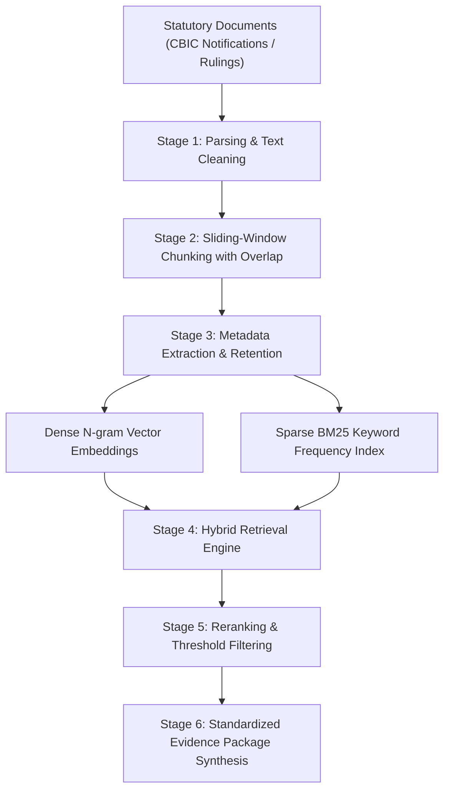

# Grounded RAG Architecture

## 1. System Overview

The **Smart GST Grounded RAG Pipeline** ingests statutory CBIC tax notifications, tariff schedules, circulars, and advance rulings to synthesize audit-verifiable, grounded evidence packages for GST classification decisions.

The pipeline adheres strictly to the zero-hallucination constraint: **"The RAG pipeline must never return unsupported claims."**



---

## 2. Mandatory Metadata Retention Specification

Every document chunk processed and indexed by the RAG pipeline retains complete statutory provenance metadata:

1. `source`: Publisher or notification identifier (e.g. `CBIC Notification No. 1/2017-Central Tax (Rate)`).
2. `source_url`: Verifiable URL linking directly to the official CBIC PDF/document.
3. `title`: Official document title.
4. `section` / `page`: Exact section or schedule entry (e.g. `Schedule III, Entry 112`, Page 1).
5. `hsn_code`: Referenced HSN code (e.g. `42031010`).
6. `effective_from`: Statutory effective start date (`2017-07-01`).
7. `effective_to`: Expiration or amendment date if applicable (`null`).
8. `metadata`: Custom key-value pairs (e.g. `{"publisher": "CBIC", "chapter": "42", "schedule": "III"}`).

---

## 3. Standardized Evidence Schema

All retrieval endpoints return evidence packaged strictly in the **StandardizedEvidence** schema format:

```json
{
  "source": "CBIC Notification No. 1/2017-Central Tax (Rate)",
  "source_url": "https://cbic-gst.gov.in/pdf/Notification1-CGST-Rate.pdf",
  "title": "CBIC Notification No. 1/2017-Central Tax (Rate), Schedule III",
  "excerpt": "Heading 4203 applies to articles of apparel and clothing accessories, of leather or of composition leather. Standard GST rate is 18% (9% CGST + 9% SGST). Excludes articles of fur under heading 4303.",
  "relevance_score": 0.92,
  "effective_from": "2017-07-01",
  "effective_to": null,
  "metadata": {
    "document_id": "CBIC-NOTIF-01-2017-SCHED3",
    "chunk_id": "CBIC-NOTIF-01-2017-SCHED3-S0-C0",
    "section": "Schedule III, Entry 112",
    "page": 1,
    "hsn_code": "42031010",
    "publisher": "CBIC",
    "chapter": "42",
    "schedule": "III"
  }
}
```

---

## 4. Grounding Guardrails

- **Relevance Score Threshold**: Chunks with a hybrid relevance score below `0.20` are automatically dropped to prevent injecting irrelevant or unsupported context.
- **Strict Provenance Check**: Every returned excerpt must link to a valid `source_url` and statutory notification number.
- **Zero Hallucination Guarantee**: No LLM text generation occurs without anchoring to an extracted `StandardizedEvidence` object.
