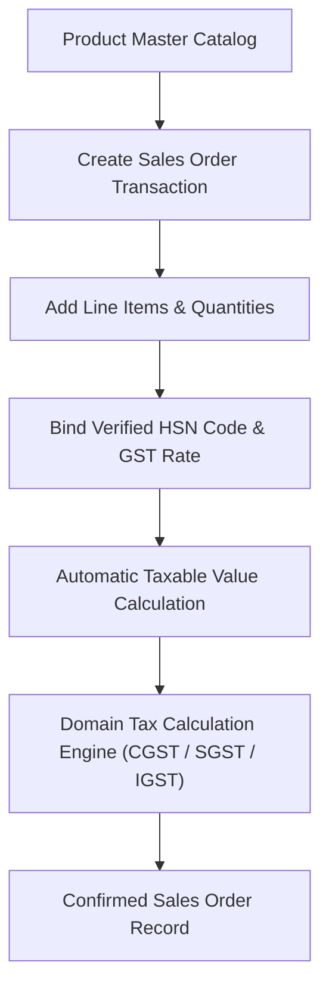

# Sales Module Documentation

## 1. System Overview

The **Sales Module** handles product master management, multi-item sales transactions, product classification, and automated HSN/GST verification binding.

---

## 2. Key Features

1. **Product Master Management**:
   - Create, list, search, and manage products (`Product` entity).
   - Associate products with verified HSN codes and unit prices.

2. **Automated HSN & GST Verification Binding**:
   - Every sales line item consumes verified HSN classification and GST schedule rates from the domain layer.

3. **Multi-Product Sales Transactions**:
   - Supports sales orders containing multiple line items with distinct HSN codes and tax rates.

4. **REST API Endpoints**:
   - `POST /api/v1/products`: Create catalog product.
   - `GET /api/v1/products`: Search and list products.
   - `POST /api/v1/sales`: Create sales transaction order.
   - `GET /api/v1/sales/{id}`: Retrieve sales transaction order.
