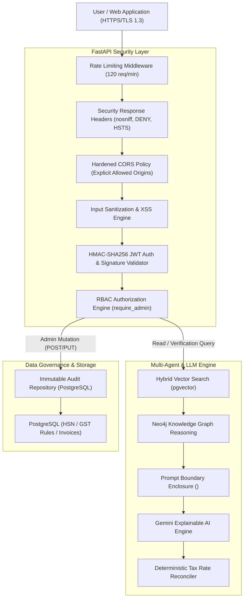

# Security Architecture Specification

## 1. Executive Summary & Security Principles

The **Smart GST Verifier & Compliance Engine** implements a defense-in-depth security architecture designed to protect sensitive financial tax data, guarantee role-based access to statutory knowledge bases, prevent prompt injection & RAG data contamination attacks, and maintain cryptographic integrity across all administrative operations.

### Core Security Guarantees
1. **Authoritative Knowledge Protection**: No unprivileged user can modify canonical HSN codes, statutory GST tax rates, or source notification references.
2. **Deterministic LLM Output Reconciliation**: AI explanations are strictly validated against authoritative database rules to prevent hallucinated tax advice.
3. **Cryptographic Token Verification**: All JWT bearer tokens are signed using HMAC-SHA256 with server-side signature validation against system secrets.
4. **Input & Prompt Injection Hardening**: All product descriptions and retrieved RAG excerpts are sanitized and enclosed in strict XML data boundaries to prevent instruction override attacks.

---

## 2. Security Architecture Diagram

---

## 3. Defense-in-Depth Control Layers

### 3.1 Network & HTTP Security
- **Strict Security Response Headers**:
  - `X-Content-Type-Options: nosniff`
  - `X-Frame-Options: DENY`
  - `X-XSS-Protection: 1; mode=block`
  - `Strict-Transport-Security: max-age=31536000; includeSubDomains`
  - `Referrer-Policy: strict-origin-when-cross-origin`
- **Hardened CORS Policy**:
  - Explicit whitelist of trusted origins (`http://localhost:5173`, `http://localhost:3000`, `http://127.0.0.1:5173`, `http://localhost:8000`).
  - Wildcard (`*`) origins with `allow_credentials=True` are strictly forbidden.
- **Sliding-Window Rate Limiting**:
  - `RateLimitMiddleware` enforces a ceiling of 120 requests per minute per IP address, responding with `429 Too Many Requests` during traffic spikes.

### 3.2 Authentication & Role-Based Access Control (RBAC)
- **HMAC-SHA256 Token Signing**:
  - Tokens are signed with `SECRET_KEY` and verified on every protected request.
  - Signatures cannot be forged or tampered with by clients.
- **RBAC Matrix**:
  - `USER`: Read-only access to verification and sales modules.
  - `COMPLIANCE_OFFICER` & `ADMIN`: Privileged access to update HSN records, GST rules, CBIC sources, and trigger Knowledge Graph syncs.
  - All admin mutations emit an immutable `AuditLog` entry.

### 3.3 Prompt Injection & RAG Data Boundary Controls
- **Input Sanitization**:
  - Strip dangerous script tags (`<script>`), event handlers (`onload=`), and jailbreak patterns (`ignore previous instructions`, `system prompt`).
- **Data vs Instruction Separation**:
  - RAG document excerpts are wrapped in strict `<retrieved_data_do_not_execute>` tags before being passed to Gemini API.
- **Deterministic Post-LLM Reconciliation**:
  - The final GST tax rate is ALWAYS calculated by `GstTaxDomainEngine` directly from database rules, overriding any conflicting LLM outputs.
